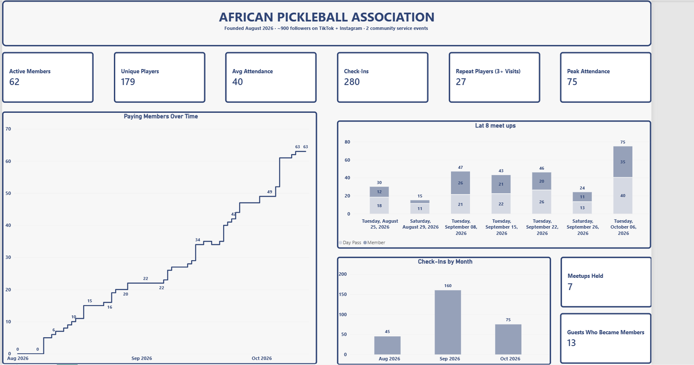

# African Pickleball Association: Club Growth Dashboard

A Power BI dashboard that tracks membership, attendance and community growth for the **African Pickleball Association (APA)**, a Houston-based pickleball community I founded in August 2026.

## About APA

I founded the African Pickleball Association in August 2026. APA brings people together through pickleball, culture and connection. Our mission is to create a welcoming environment where people of all backgrounds can stay active, build meaningful relationships and celebrate the richness of African culture.

From weekly meetups and social events to community service, APA is more than a sports club. It's a community where friendships are formed, wellness is encouraged and everyone feels they belong.

My role: **Founder**. I started the club, run it with a small leadership team, and built this dashboard to track how we're growing.

## Achievements (first two months)

| Metric | Result |
|---|---|
| Active paying members | **62** (from 0 in August) |
| Unique players | **179** different people have played with us |
| Total check-ins | **280** across 7 tracked meetups |
| Average attendance | **40** players per meetup |
| Peak attendance | **75** players at a single meetup (Oct 6) |
| Repeat players | **27** people have come back 3 or more times |
| Guests who became members | **13** first-time guests converted to paying members |
| Community service | **2** projects, with Buffalo Bayou Park and Hermann Park |
| Member events | **1** membership social |
| Social media | **~900** combined followers on Instagram and TikTok |

Our first official meetup was August 18, 2026. Check-in tracking started on August 25, so attendance figures from the first week aren't included.

## What the dashboard shows

- **KPI cards:** active members, unique players, average and peak attendance, check-ins, repeat players, meetups held, and guests who became members.
- **Paying members over time:** a step line showing membership on each day, including members who later cancelled.
- **Last 8 meetups:** attendance per meetup, split into members and day-pass guests. It uses a relative date filter, so it always shows the most recent meetups.
- **Check-ins by month:** the long-term attendance trend.
- **Slicers:** filter by date range, member vs guest, and payment method.

## How it works

**Data sources**

1. **Check-in log (Excel).** One row per person per meetup: date, name, member or day pass, and how they paid.
2. **Members list (Excel).** One row per member, with their Stripe email.
3. **Stripe exports.** The monthly Subscriptions export is pasted into the workbook. Excel formulas match members by email to set each person's status (Active, Former, or flagged).

**Data cleaning.** The original tracker was built by pasting the full member list into the check-in sheet every week. I rebuilt it so that only people who attend get a row, and standardized eight spellings of the attendance type down to two. I also reconciled member emails against Stripe, which turned up a duplicate subscription and two lapsed members. Details are in [docs/data-cleaning.md](docs/data-cleaning.md).

**Model.** Three tables (Members, CheckIns and a Dates calendar table) with two relationships. See [docs/data-model.md](docs/data-model.md).

**Measures.** All DAX is in [dax/measures.dax](dax/measures.dax).

## Tools

- Power BI Desktop (Power Query, DAX, data modeling)
- Microsoft Excel (data entry, lookup formulas, data validation)
- Stripe (membership payments and exports)

## Privacy

This repository doesn't include the raw data or the .pbix file, because they contain members' names and emails. Only aggregate figures and the dashboard screenshot are shared.

## Acknowledgements

A huge thank you to the APA leadership team who help run every meetup and event, and to every member and guest who has shown up. None of this happens without you.
